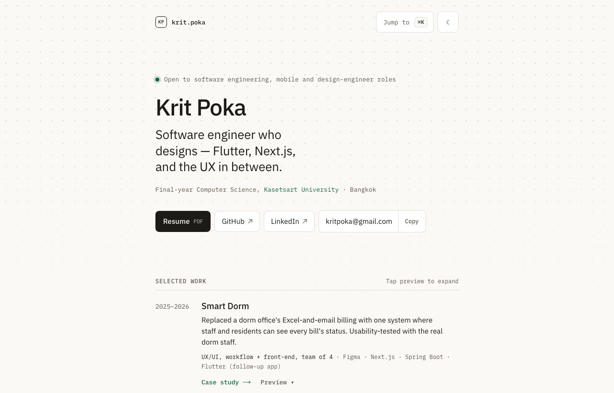
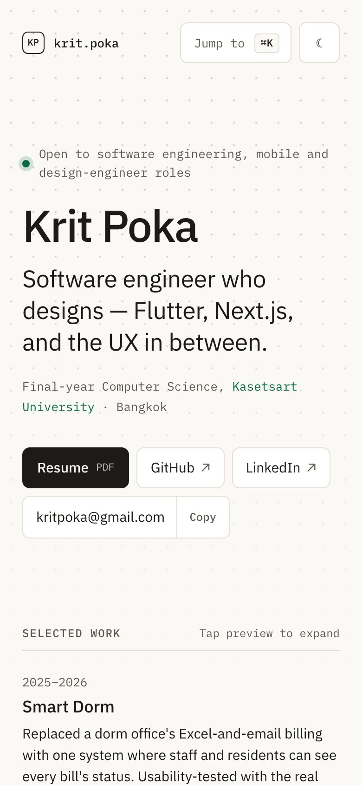

# krit.poka — portfolio

Personal site of Krit Poka, a software engineer who designs: Flutter, Next.js, and the UX in between. A short homepage and four case studies, built as a fully static Next.js site.

**Live:** https://kritpoka-portfolio.vercel.app




> Want to know how it works? Read [docs/ARCHITECTURE.md](docs/ARCHITECTURE.md).

## Features

- **Case studies in MDX.** Each project is one file in `content/work/` with typed front matter and a shared set of building blocks.
- **⌘K / Ctrl+K command menu** (cmdk), loaded only the first time it opens.
- **Selected-work rows** with a hover or focus preview on wide screens with a mouse, and a "Preview" toggle everywhere else.
- **Light and dark theme.** It follows the OS until the toggle is used, and the choice is applied before first paint.
- **Click-to-load 3D map.** The KU Campus Map case study embeds the live map in an iframe only after a click.
- **Per-page share images** (Open Graph), generated at build time, plus a sitemap, `robots.txt` and JSON-LD.
- **Static output.** Every page is prerendered; the build fails if one stops being static.

## Tech stack

| Piece | Why |
|---|---|
| [Next.js](https://nextjs.org) 16 (App Router, Cache Components) | File-based routes, `generateStaticParams`, `next/og`, `next/font` and `next/image` in one place. |
| React 19 + TypeScript | UI, and typed case study metadata (`lib/types.ts`). |
| [Tailwind CSS](https://tailwindcss.com) 4 | Utility styling on top of CSS-variable design tokens (`app/globals.css`). |
| `@next/mdx` | Case studies are content, not code: prose plus a few components. |
| [cmdk](https://cmdk.paco.me) + Radix Dialog | The command menu, with focus handling and keyboard navigation built in. |
| `next/font` (IBM Plex Sans and Mono, Instrument Serif) | Self-hosted fonts with metric-matched fallbacks, so text doesn't shift. |
| `sharp` | The image script (`scripts/optimize-images.mjs`): resize, crop, blur, WebP. |
| Vercel + `@vercel/analytics` | Hosting, and four custom events (resume click, email copy, email click, case study open). |

## Quick start

Requires Node 22 or newer and npm.

```bash
npm install
npm run dev                  # http://localhost:3000
npm run build                # production build; fails if any page stops being static
npm start                    # serve the production build
npm run lint
npx tsc --noEmit             # type-check
node scripts/optimize-images.mjs   # regenerate public/work/** from sources/assets/ (see ARCHITECTURE.md)
```

## Project structure

```
app/
  layout.tsx            root layout: metadata, theme script, command menu host, analytics
  page.tsx              homepage (+ Person JSON-LD)
  work/[slug]/page.tsx  one case study; opengraph-image.tsx next to it
  opengraph-image.tsx   homepage share image
  sitemap.ts, robots.ts, not-found.tsx, icon.svg, apple-icon.tsx, globals.css
content/
  work/*.mdx            the four case studies (front matter + MDX body)
  home.ts               homepage copy: selected work, experience, more projects, recognition
  media.ts              GENERATED image metadata; do not edit by hand
components/
  case/                 case study building blocks (Section, Decision, Outcome, heroes, screenshots)
  diagrams/             HTML/CSS diagrams used in the case studies
  command/              ⌘K menu
  home/ProjectRow.tsx   selected-work row with its preview
  reveal.ts             page-load reveal helper
lib/
  site.ts               name, links, SITE_URL, build date
  work.ts               case study registry, ordering and next-project links
  og.tsx                shared Open Graph card renderer (+ og-fonts/)
  theme.ts, fonts*.ts, analytics.ts, palette.ts, types.ts
mdx-components.tsx      registers every component MDX files can use
scripts/optimize-images.mjs   image pipeline
public/                 resume.pdf and optimized work images
docs/                   ARCHITECTURE.md and screenshots
```

## Editing content

- **A case study:** edit `content/work/<slug>.mdx`. The front matter (`export const meta`) is typed by `CaseMeta` in `lib/types.ts`, and the body uses the registered components with no imports.
- **The homepage:** edit `content/home.ts`. `selectedWork` drives the project rows; `moreProjects`, `experience` and `recognition` are plain lists.
- **A new project:** create the MDX file, register it in `lib/work.ts`, and add a homepage row. The numbered steps are in [CLAUDE.md](CLAUDE.md#adding-a-project), and the end-to-end walkthrough is in [docs/ARCHITECTURE.md](docs/ARCHITECTURE.md#walkthrough-add-a-new-case-study).
- **Content and design rules** (what may and may not appear on the site, design tokens, type scale) live in [CLAUDE.md](CLAUDE.md).

## Configuration

| Variable | Purpose |
|---|---|
| `SITE_URL` | Canonical origin, e.g. `https://example.com`. Sets `metadataBase`, so it ends up in every canonical link, `og:url`, `og:image`, the sitemap and `robots.txt`. |

If `SITE_URL` is unset the site uses `VERCEL_PROJECT_PRODUCTION_URL` on Vercel, and `http://localhost:3000` otherwise. Set it explicitly for production: link-preview scrapers fetch the share image from exactly that address, so a wrong value means a missing preview. The footer's "Last updated" date is the build date.

## Deploy

The site is a Vercel project. Deploy with the Vercel CLI:

```bash
vercel deploy          # preview
vercel deploy --prod   # production
```

- **Environment:** set `SITE_URL` for Production (`vercel env add SITE_URL production`), then redeploy so the build picks it up.
- **Deployment Protection:** when it is on, scrapers (LINE, Facebook, LinkedIn, X) get a login redirect and show no preview. Link previews only work on a publicly reachable URL.
- **Custom domain:** when one is connected, add it in Vercel, change `SITE_URL` to it and redeploy.
- **Git integration:** pushes to GitHub don't deploy yet; connect the repository in the Vercel project settings to enable that.

## Roadmap

- Screenshots for the Smart Dorm case study
- Custom domain
- Automatic deploys from `main`

## License

All rights reserved. The code is public to read, but no licence to reuse it, or the text and images, is granted.
